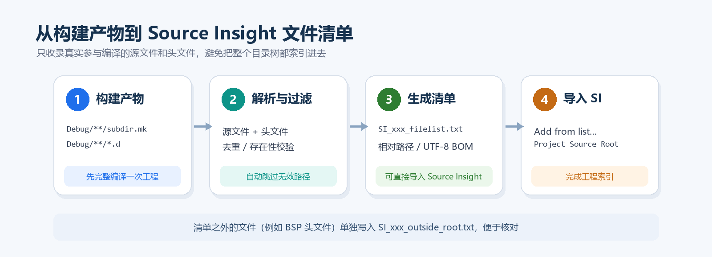
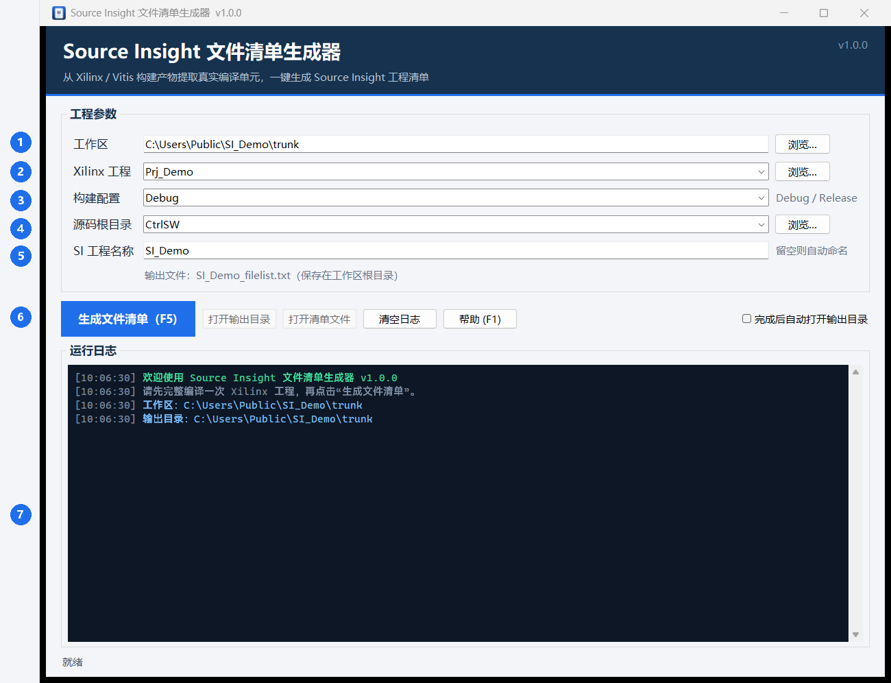
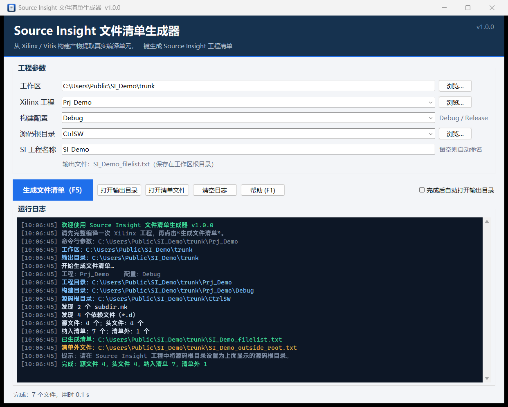
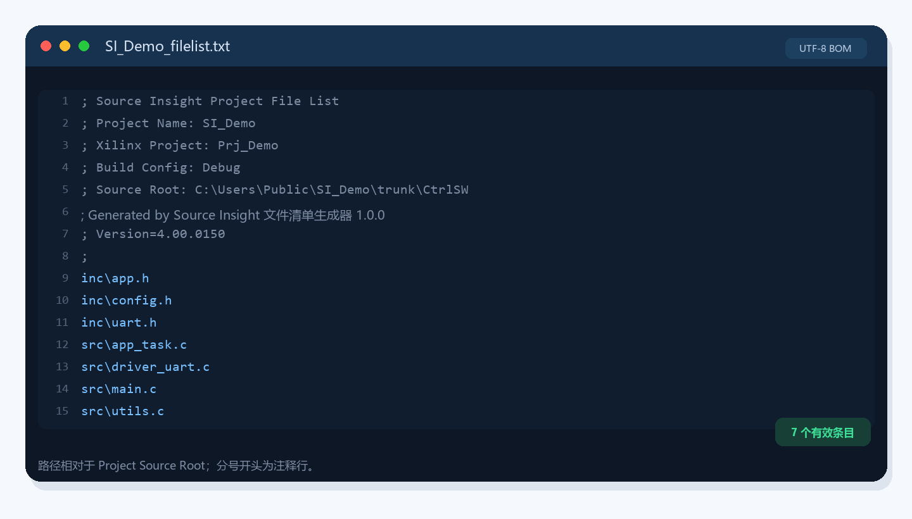

# Source Insight 文件清单生成器 · 使用教程

> 适用版本：**v1.0.0** ｜ 适用系统：Windows 10 / 11 ｜ 程序形式：单文件 exe，无需安装 Python

这个工具从 Xilinx / Vitis（Eclipse CDT）工程的**真实构建产物**中提取实际参与编译的源文件和头文件，生成 Source Insight 可以直接导入的文件清单。

<!-- TOC -->

---

## 1. 这个工具解决什么问题

直接把整个工程目录树加入 Source Insight，通常会把下面这些内容也索引进去：

- 没有被任何构建配置使用的旧文件、备份文件；
- BSP、驱动、库目录中大量与当前工程无关的源码；
- 已经删除、但仍残留在目录中的文件。

结果是符号跳转变慢、搜索结果变杂，甚至出现同名符号干扰。

本工具只读取编译结果：

- 从 `Debug/**/subdir.mk` 中提取 `C_SRCS`、`CPP_SRCS`、`CXX_SRCS`、`ASM_SRCS` 等变量里的源文件；
- 从 GCC 生成的 `Debug/**/*.d` 依赖文件中提取真正被包含的头文件；
- 自动去重、检查文件是否仍然存在、按源码根目录过滤；
- 输出一份相对路径清单，直接交给 Source Insight。



*图 1：从构建产物到 Source Insight 清单的处理流程*

| 项目 | 内容 |
|---|---|
| 输入 | `subdir.mk`（源文件列表）、`*.d`（头文件依赖） |
| 输出 | `SI_xxx_filelist.txt`（主清单）、`SI_xxx_outside_root.txt`（清单外文件，按需生成） |
| 前提 | 工程已经用目标配置**完整编译过一次** |

---

## 2. 使用前准备

### 2.1 先完整编译一次工程

在 Vitis / Xilinx SDK 中选择要使用的构建配置（通常是 `Debug`），执行一次完整编译。

编译完成后，确认构建目录中存在 `subdir.mk` 和 `*.d` 文件。典型结构如下：

```text
trunk\
├─ CtrlSW\                     ← 源码根目录（示例）
│  ├─ src\
│  │  ├─ main.c
│  │  ├─ app_task.c
│  │  └─ ...
│  └─ inc\
│     ├─ app.h
│     └─ ...
├─ BSP\
│  └─ include\                 ← 可能在源码根之外
│     └─ xil_io.h
└─ Prj_Demo\             ← Xilinx 工程
   └─ Debug\                   ← 构建配置目录
      ├─ subdir.mk
      └─ src\
         ├─ subdir.mk
         ├─ main.d
         └─ ...
```

> **重要**：头文件依赖来自 `*.d` 文件。如果编译器没有开启 `-MMD` / `-MP` 一类依赖生成选项，生成结果里只会包含源文件，头文件列表为空。

### 2.2 放置程序

从 [GitHub Releases](https://github.com/liamcheng2000/Sourceinsight-Tools/releases) 下载 `SI文件清单生成器.exe`。它是单文件程序，可以放在任意位置，不需要安装。

推荐把它放在**工作区根目录**（也就是同时包含 `Prj_*` 工程和 `CtrlSW` 的目录）。这样双击启动后，程序会自动定位到当前目录，省去手动选择。

---

## 3. 认识主界面

双击运行程序，界面如下：



*图 2：主界面（编号与下表对应）*

| 编号 | 区域 | 说明 |
|---|---|---|
| 1 | 工作区 | 包含 Xilinx 工程和源码根目录的根目录 |
| 2 | Xilinx 工程 | 工程文件夹，通常是 `Prj_*`；可从下拉框选择，也可手动输入 |
| 3 | 构建配置 | 通常是 `Debug`，也可以是 `Release` 或自定义配置目录名 |
| 4 | 源码根目录 | 希望 Source Insight 索引的源码根，通常是 `CtrlSW` |
| 5 | SI 工程名称 | Source Insight 工程名；留空会自动生成 |
| 6 | 生成文件清单 | 开始解析并生成清单，快捷键 `F5` |
| 7 | 运行日志 | 显示解析过程、文件数量、输出路径和错误信息 |

生成按钮右侧还有 **“帮助 (F1)”** 按钮。点击它（或按 `F1`）会用默认浏览器打开本教程的内置版本，不需要联网，也不需要额外安装 Markdown 阅读器。

> 点击“帮助”时，程序会把教程复制到 `%APPDATA%\SourceInsightFileList\使用教程.html`，然后调用系统默认浏览器。如果浏览器没有自动弹出，可以手动打开这个文件。

---

## 4. 三步生成清单

### 第一步：选择工作区

点击“工作区”右侧的 **浏览…**，选择包含工程和源码的根目录。

- 选择后，程序会自动扫描其中的 `Prj_*` 工程，填充“Xilinx 工程”下拉框；
- 如果工程不在工作区里，也可以直接选择工程目录，程序会自动把它的父目录作为工作区；
- 路径中带中文或空格都可以正常使用。

### 第二步：确认工程与构建配置

从下拉框选择工程，程序会自动识别该工程下包含 `subdir.mk` 的配置目录（如 `Debug`、`Release`）。

- 如果下拉框没有出现想要的配置，可以直接手动输入目录名；
- 切换工程后，SI 工程名称会自动更新为 `SI_<去掉 Prj_ 前缀的工程名>`；
- 如果之前手动改过 SI 名称，程序不会强行覆盖。

### 第三步：点击“生成文件清单”

点击 **生成文件清单 (F5)** 或按 `F5`。解析在后台线程执行，界面不会卡住。

生成成功后，日志区会显示统计信息和输出路径，底部状态栏显示耗时：



*图 3：生成完成后的日志与状态*

日志中的关键数字含义：

| 字段 | 含义 |
|---|---|
| 源文件 | 从 `subdir.mk` 中解析到的有效 `.c` / `.cpp` / `.s` 文件数量 |
| 头文件 | 从 `*.d` 中解析到的有效 `.h` / `.hpp` 文件数量 |
| 纳入清单 | 位于源码根目录之内、写入主清单的文件数量 |
| 清单外 | 构建使用、但位于源码根目录之外的文件数量 |

生成完成后，“打开输出目录”和“打开清单文件”按钮会变为可用。如果勾选了“完成后自动打开输出目录”，程序会自动打开资源管理器。

> 提示：解析过程中如果遇到无法解析的 Make 变量路径，程序会跳过并在日志中给出警告，不会中断整个生成过程。

---

## 5. 参数说明

| 参数 | 示例 | 说明 |
|---|---|---|
| 工作区 | `D:\work\trunk` | 包含 Xilinx 工程和源码根目录的根目录 |
| Xilinx 工程 | `Prj_Demo` | 相对路径基于工作区；也可以填入绝对路径 |
| 构建配置 | `Debug` | 工程下包含 `subdir.mk` 的目录名 |
| 源码根目录 | `CtrlSW` | 相对路径基于工作区；也可以填入绝对路径 |
| SI 工程名称 | `SI_Demo` | 留空时自动生成；不能包含 `< > : " / \`、竖线、`? *` |

几个容易混淆的点：

1. **源码根目录决定清单中的相对路径。** 主清单里的路径都是相对于这个目录的。Source Insight 工程里的 `Project Source Root` 必须与它一致。
2. **SI 工程名称只影响输出文件名和清单头注释**，不会修改工程本身。
3. **构建配置必须已经存在并且编译过。** 只创建一个空的 `Release` 目录没有用。
4. **相对路径和绝对路径都支持。** 相对路径以工作区为基准，绝对路径则直接使用。

---

## 6. 输出文件说明

### 6.1 主清单 `SI_xxx_filelist.txt`



*图 4：主清单内容示例（实际文件为 UTF-8 BOM + CRLF）*

文件格式特点：

- 编码为 **UTF-8 BOM**，换行符为 **CRLF**，兼容 Source Insight 和常见 Windows 工具；
- 以 `;` 开头的行是注释，Source Insight 会忽略；
- 正文每行一个文件，使用相对于源码根目录的路径，分隔符为 `\`；
- 文件按路径排序，已去重；
- 源文件和头文件混排，不区分类型。

文件头示例：

```text
; Source Insight Project File List
; Project Name: SI_Demo
; Xilinx Project: Prj_Demo
; Build Config: Debug
; Source Root: C:\Users\Public\SI_Demo\trunk\CtrlSW
; Generated by Source Insight 文件清单生成器 1.0.0 at 2026-10-28 16:16:09
; Version=4.00.0150
;
inc\app.h
inc\config.h
src\main.c
src\utils.c
```

### 6.2 清单外文件 `SI_xxx_outside_root.txt`

构建使用、但位于源码根目录之外的文件（常见的是 BSP、驱动、库头文件）不会写入主清单，而是单独输出：

```text
; Files used by the build but outside the selected Source Insight source root:
; Source root: C:\Users\Public\SI_Demo\trunk\CtrlSW
; These files are NOT written into the Source Insight file list.
;
C:\Users\Public\SI_Demo\trunk\BSP\include\xil_io.h
```

这样处理的原因：主清单中的路径是相对路径，如果把源码根之外的文件也写进去，Source Insight 无法正确解析。

如果希望这些文件也进入索引，有两个办法：

- 把“源码根目录”改为更高的公共父目录（例如整个 `trunk`），然后同步修改 Source Insight 的 `Project Source Root`；
- 或者先查看 `*_outside_root.txt`，确认这些文件确实不需要索引。

### 6.3 重复生成时的行为

- 同名主清单会被**直接覆盖**；
- 如果本次没有清单外文件，程序会自动删除上次遗留的同名 `*_outside_root.txt`；
- 建议每次重新编译后都重新生成一次，避免清单与构建结果不一致。

---

## 7. 导入 Source Insight

1. 打开（或新建）Source Insight 工程。
2. 选择菜单 **Project → Add and Remove Project Files…**。
3. 点击 **Add from list…**。
4. 选择生成的 `SI_xxx_filelist.txt`。
5. 确认 `Project → Project Settings…` 中的 **Project Source Root** 与界面显示的源码根目录一致。
6. 确认添加后，等待 Source Insight 完成符号解析。

> 不同 Source Insight 版本的菜单文字可能略有差异；核心是找到“从列表添加文件”和“工程源码根目录”这两个设置。

导入后如果出现找不到文件、路径错位，优先检查：

- `Project Source Root` 是否等于生成时显示的源码根目录；
- 是否在移动工程目录后仍然使用旧清单；
- 清单文件是否被编辑器改成了非 UTF-8 编码（一般不需要手动编辑）。

---

## 8. 命令行与拖拽

命令行参数与原 PowerShell 脚本保持一致：

```bat
SI文件清单生成器.exe PROJECT [SourceRoot] [SIProjectName] [Config]
```

示例：

```bat
REM 只传工程名：源码根默认 CtrlSW，配置默认 Debug，SI 名称自动生成
SI文件清单生成器.exe Prj_Demo

REM 完整指定
SI文件清单生成器.exe Prj_Demo CtrlSW SI_Demo Debug

REM 直接传工程绝对路径：工作区自动取其父目录
SI文件清单生成器.exe D:\work\trunk\Prj_Demo
```

行为说明：

- 带参数启动时，程序会先打开界面，然后自动开始生成；
- 只传工程名时，会优先在上次使用的工作区中查找；找不到则回退到 exe 所在目录；
- 也可以直接把**工程文件夹拖到 exe 上**，效果等同于传入工程绝对路径；
- 生成过程中仍然可以在界面上看到完整日志。

---

## 9. 常见问题

### Q1：提示“未找到 subdir.mk，无法确定实际参与编译的文件”

说明所选构建配置目录下没有构建产物。请先使用该配置完整编译一次工程，并确认“构建配置”选择正确。

### Q2：头文件列表为空

检查编译器是否开启了依赖文件生成（如 `-MMD -MP`）。如果没有 `*.d` 文件，工具无法知道实际包含了哪些头文件，只能提取源文件。

### Q3：清单里没有 BSP 或驱动头文件

它们通常位于源码根目录之外，只会出现在 `SI_xxx_outside_root.txt` 中。如果确实需要索引，请把源码根目录调整为更高的公共父目录，并同步修改 Source Insight 的 `Project Source Root`。

### Q4：提示“构建目录不存在”

“构建配置”填写的是工程下的目录名。请确认类似 `Prj_Demo\Debug` 的目录真实存在，而不是只写了配置名称。

### Q5：路径里有中文或空格，会有问题吗

不会。程序内部使用 Unicode 路径处理；makefile 中的转义空格（如 `my\ file.c`）也会被正确还原。Source Insight 工程本身也支持中文路径。

### Q6：首次启动比较慢，或者被 SmartScreen 拦截

单文件 exe 首次启动需要解压运行时，通常 1～3 秒，属于正常现象。程序未做代码签名，Windows 可能提示“未知发布者”；确认文件来源可信后，可以选择“更多信息 → 仍要运行”。

### Q7：设置保存在哪里

`%APPDATA%\SourceInsightFileList\settings.json`。删除该文件即可恢复默认设置。程序不会向 exe 所在目录写入配置。

### Q8：点击“帮助”没有反应

程序会先把内置教程复制到 `%APPDATA%\SourceInsightFileList\使用教程.html`，再调用系统默认浏览器。如果浏览器没有弹出，可以手动打开这个文件；也可以检查系统是否设置了默认浏览器。

### Q9：已删除的源文件还会出现在清单里吗

不会。程序会检查文件是否存在，构建残留中已经删除的路径会被过滤掉。但仍然建议在增删源码后重新编译并重新生成。

### Q10：生成的清单可以直接手动编辑吗

可以，但不推荐。下次生成会覆盖同名文件。如果只是临时调整，建议另存为其他文件名再导入。

---

## 10. 重新打包（可选）

只有在修改源码后才需要重新打包。环境要求：

- Windows 10/11 x64；
- Python 3.10 或更高版本（本项目在 Python 3.14 + PyInstaller 6.21 下验证）；
- Python 包：`pyinstaller`、`markdown`、`pillow`。

```bat
python -m pip install pyinstaller markdown pillow
build_exe.bat
```

`build_exe.bat` 会先运行 `build_help.py`，把 `使用教程.md` 和 `docs\images\` 中的图片打包成一个自包含的 `help.html`，然后调用 PyInstaller 生成：

```text
dist\SI_FileList_Generator.exe
```

把生成的 exe 复制到工作区根目录并改名为 `SI文件清单生成器.exe` 即可本地使用；对外发布时，把它上传到 **GitHub Releases**，不要提交到源码仓库。

> `help.html` 是运行时内置教程；`使用教程.html` 是同样内容的独立分享版。两者都是本地生成物，不随仓库提交，也不依赖网络。

---

## 附录 A：清单头字段

| 字段 | 说明 |
|---|---|
| `Project Name` | Source Insight 工程名 |
| `Xilinx Project` | 工程文件夹名 |
| `Build Config` | 使用的构建配置 |
| `Source Root` | 生成时使用的源码根目录绝对路径 |
| `Generated by` | 工具名称、版本和生成时间 |
| `Version` | 清单格式版本，当前为 `4.00.0150` |

## 附录 B：目录文件说明

| 文件 | 说明 |
|---|---|
| `GitHub Releases` | 单文件 exe 的下载位置，不放进源码仓库 |
| `si_core.py` | 核心解析与清单生成逻辑，无 GUI 依赖 |
| `si_filelist_gui.py` | Tkinter 图形界面入口 |
| `test_si_core.py` | 核心逻辑自测 |
| `build_help.py` | 把 Markdown 教程转换为自包含 HTML |
| `build_exe.bat` | 一键重新打包 |
| `使用教程.md` | 教程源文件（本文件） |
| `使用教程.html` | 本地生成的独立分享版，不提交到仓库 |
| `help.html` | 打包进 exe 的内置教程，构建时生成，不提交到仓库 |
| `docs\images\` | 教程配图 |
| `app.ico` / `make_icon.py` | 程序图标及生成脚本 |
| `version_info.txt` | exe 版本信息资源 |
| `gen_sourceinsight_filelist.bat` / `.ps1` | 原始 PowerShell 版本，保留作参考 |
| `RM.txt` | 原始脚本的示例运行命令 |

---

*Source Insight 文件清单生成器 v1.0.0*
